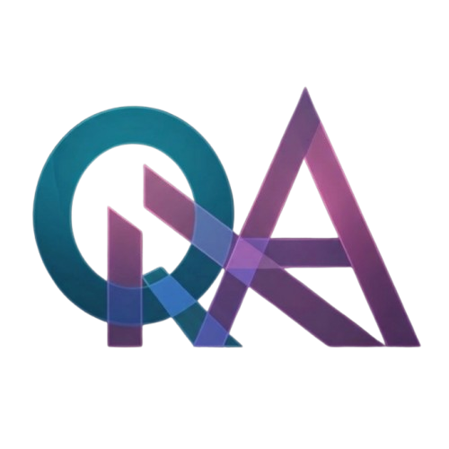

<!-- Improved compatibility of back to top link: See: https://github.com/othneildrew/Best-README-Template/pull/73 -->
<a id="readme-top"></a>
<!--
*** Thanks for checking out the Best-README-Template. If you have a suggestion
*** that would make this better, please fork the repo and create a pull request
*** or simply open an issue with the tag "enhancement".
*** Don't forget to give the project a star!
*** Thanks again! Now go create something AMAZING! :D
-->


<!-- PROJECT SHIELDS -->
<!--
*** I'm using markdown "reference style" links for readability.
*** Reference links are enclosed in brackets [ ] instead of parentheses ( ).
*** See the bottom of this document for the declaration of the reference variables
*** for contributors-url, forks-url, etc. This is an optional, concise syntax you may use.
*** https://www.markdownguide.org/basic-syntax/#reference-style-links
-->
[![Release][release-shield]][release-url]
[![Downloads][downloads-shield]][downloads-url]
[![Stars][stars-shield]][stars-url]
[![Issues][issues-shield]][issues-url]
[![Status Alpha][alpha-shield]][changelog-url]
[![Platform Windows][windows-shield]][release-url]


<!-- PROJECT LOGO -->
<br />
<div align="center">
  <a href="https://github.com/obidur-rahman/axiom-learning">
    
  </a>

  <h3 align="center">Axiom Learning</h3>

  <p align="center">
    A local-first desktop study app for exam season. It reads the material you already have
    and turns it into an exam-scoped plan, a cited teaching board, a grounded tutor,
    written-answer practice and mock exams.
    <br />
    <a href="#about-the-project"><strong>Explore the docs »</strong></a>
    <br />
    <br />
    <a href="https://github.com/obidur-rahman/axiom-learning/releases/download/v0.1.0/Axiom.Learning_0.1.0_x64-setup.exe">Download</a>
    &middot;
    <a href="https://github.com/obidur-rahman/axiom-learning/releases">Releases</a>
    &middot;
    <a href="https://github.com/obidur-rahman/axiom-learning/issues">Report Bug</a>
    &middot;
    <a href="https://github.com/obidur-rahman/axiom-learning/issues/new?labels=enhancement">Request Feature</a>
  </p>
</div>


<!-- TABLE OF CONTENTS -->
<details>
  <summary>Table of Contents</summary>
  <ol>
    <li>
      <a href="#about-the-project">About The Project</a>
      <ul>
        <li><a href="#what-it-does">What It Does</a></li>
        <li><a href="#built-with">Built With</a></li>
      </ul>
    </li>
    <li>
      <a href="#getting-started">Getting Started</a>
      <ul>
        <li><a href="#prerequisites">Prerequisites</a></li>
        <li><a href="#installation">Installation</a></li>
      </ul>
    </li>
    <li>
      <a href="#usage">Usage</a>
      <ul>
        <li><a href="#ai-provider">AI Provider</a></li>
        <li><a href="#commands">Commands</a></li>
        <li><a href="#repository-layout">Repository Layout</a></li>
        <li><a href="#documentation">Documentation</a></li>
      </ul>
    </li>
    <li><a href="#roadmap">Roadmap</a></li>
    <li><a href="#contributing">Contributing</a></li>
    <li><a href="#license">License</a></li>
    <li><a href="#contact">Contact</a></li>
    <li><a href="#acknowledgments">Acknowledgments</a></li>
  </ol>
</details>


<!-- ABOUT THE PROJECT -->
## About The Project

Everything runs on your machine. There is no account, no upload and no server:
courses, material, lessons and progress live in one local SQLite database.

> **Status: alpha (v0.1.0).** The core loop works end to end, but expect rough
> edges, missing features and schema changes between builds. See
> [Roadmap](#roadmap).

Here's why it exists:

* Exam season is short — study only what the exam actually needs, with the reason shown for every kept and skipped topic
* Your material is already on your desk — PDFs, photos of notes, past papers and pasted text are enough, no course purchase
* Trust matters — every AI answer cites your pages (`[p.3]`) or says plainly that your material does not cover the question
* Local-first — no account, no upload, no server; your data is yours, and **Settings → Data** exports the whole workspace as JSON

### What It Does

- **Courses** — create a course with level, language (English / Bangla / mixed)
  and exam date; the Dashboard shows real counts, a countdown and today's plan.
- **Material intake** — add PDFs, images or pasted text. Pages are read locally
  (pdf.js, tesseract OCR), chunked and embedded; low-confidence pages are
  flagged rather than trusted.
- **Exam-scoped roadmap** — topics are pruned deterministically into Core,
  Bridge, Skipped and Known, and every node states its reason
  (`NEEDED_BY`, `EXCLUDED`, `LOW_WEIGHT`) plus the core topics that need it.
  Pruning never happens in a model.
- **Teaching board** — lessons are built beat by beat (hook, intuition, worked
  example, contrast, note anchor, recall, exam-answer shape) with structured
  blocks, page citations and a check question. Board, Slides and Read all views
  are always available; Present goes full screen with keyboard navigation.
- **Tutor** — chat grounded in your material. Answers cite pages (`[p.3]`) or
  say plainly that the material does not cover the question. Guide-me mode asks
  a short question first.
- **Practice and question bank** — past papers are extracted into draft rows you
  confirm yourself; topics without past papers get questions labelled
  "Generated from notes - not a past paper". The ladder runs easiest to
  hardest and never mixes the two statistics.
- **Study tab** — per-course profiles (`past_first`, `notes_first`,
  `adaptive`), daily study minutes, today's plan, coverage and a review queue
  for extracted questions.
- **Mock exam** — assemble confirmed questions into a paper, write answers,
  reveal model answers and self-mark; results feed the next plan.
- **Progress** — attempts, weak topics and per-course progress, all computed
  locally.
- **Presentation** — Catppuccin light/dark theme, nine accent presets,
  translucent or solid surfaces, compact density, reduce-motion support, and a
  UI that works in both English and Bangla.

<p align="right">(<a href="#readme-top">back to top</a>)</p>


### Built With

* [![Next][Next.js]][Next-url]
* [![React][React.js]][React-url]
* [![Tauri][Tauri]][Tauri-url]
* [![Rust][Rust]][Rust-url]
* [![TypeScript][TypeScript]][TypeScript-url]
* [![SQLite][SQLite]][SQLite-url]
* [![Tailwind CSS][Tailwind]][Tailwind-url]

<p align="right">(<a href="#readme-top">back to top</a>)</p>


<!-- GETTING STARTED -->
## Getting Started

Download the installer, or build from source. Both end at the same place: a
local app that needs one AI endpoint to switch on.

### Prerequisites

Building from source needs Windows 10 or 11, plus:

* [Node.js](https://nodejs.org) 22 LTS or newer, with npm
  ```sh
  # check your version
  node --version
  ```
* [Rust](https://rustup.rs) stable (1.77+) with the MSVC toolchain, for the
  Tauri shell
  ```sh
  rustup show
  ```
* An OpenAI-compatible endpoint — a local server (LM Studio, Ollama, vLLM) is
  enough to start

### Installation

**Option A — installer (recommended):**

1. Download the latest Windows x64 installer from the
   [Releases page](https://github.com/obidur-rahman/axiom-learning/releases)
   ```sh
   # direct link for v0.1.0
   https://github.com/obidur-rahman/axiom-learning/releases/download/v0.1.0/Axiom.Learning_0.1.0_x64-setup.exe
   ```
2. Run it, then point **Settings → AI provider** at your endpoint

**Option B — build from source:**

1. Clone the repo
   ```sh
   git clone https://github.com/obidur-rahman/axiom-learning.git
   cd axiom-learning
   ```
2. Install dependencies and start
   ```sh
   npm install
   npm run tauri dev -w apps/desktop
   ```

The first launch creates the database at
`%APPDATA%\com.northaxis.axiomlearning\axiom.db` (Windows). Add a course, drop
in some material, configure the provider in Settings, then generate a roadmap
and a lesson.

<p align="right">(<a href="#readme-top">back to top</a>)</p>


<!-- USAGE EXAMPLES -->
## Usage

Use the app in three moves: **add material → generate the roadmap → open a
lesson**. Everything else (practice, mock exam, progress) builds on those.

### AI Provider

Axiom talks to any OpenAI-compatible chat + embeddings endpoint:

- **Local** — LM Studio, Ollama, vLLM, llama.cpp server. Desktop requests go
  through Tauri's HTTP client, so local servers need no CORS configuration.
- **Hosted** — any OpenAI-compatible API (OpenRouter, OpenAI, Groq…). The key
  is stored in the OS credential store (Windows Credential Manager), never in
  browser storage.

Configure it in **Settings → AI provider**: pick a hosted provider and its base
URL fills in, or paste the API key and the chat, OCR and embedding model names
are read from the endpoint's model list. **Save and probe** then checks what the
endpoint can actually do and shows a capability summary. Features expand or
shrink with what your provider supports — embeddings off, for example, falls
back to keyword retrieval.

Material text is always data, never instructions: the pipeline keeps model
output behind Zod schemas and renders lesson content as structured blocks, not
arbitrary HTML.

_For more details, please refer to the [Documentation](#documentation)_

### Commands

| Command | What it does |
| --- | --- |
| `npm run tauri dev -w apps/desktop` | Run the desktop app in dev mode (Next dev server + Tauri) |
| `npm run dev:desktop` | Web UI only, against `http://localhost:3000` |
| `npm run typecheck` | TypeScript across every workspace |
| `npm test` | Unit tests (vitest) across every workspace |
| `npm run build` | Static export of the UI into `apps/desktop/out` |
| `npm run tauri build -w apps/desktop` | Production build + Windows NSIS installer |

### Repository Layout

```
apps/desktop           Next.js UI (static export) + Tauri 2 shell
  src/app              routes, global tokens and styles
  src/components       app shell, panels, course workspace, settings
  src/lib              job worker, speech, export, provider bridge
  src-tauri            Rust shell: SQLite, HTTP, dialogs, Windows keyring
packages/data          schema, migrations, row mapping, repositories
packages/engine        deterministic roadmap pruning and study planner
packages/pipeline      job steps: read, chunk, embed, roadmap, lesson, tutor
packages/ai            provider-agnostic model client and prompt schemas
docs                   PRD, TRD, schema, design brief, flow, plans
```

`packages/engine` is code, never a model: pruning, ordering and planning are
reproducible and unit-tested.

### Documentation

| File | Contents |
| --- | --- |
| [PRODUCT.md](PRODUCT.md) | What ships in this build, and what is deliberately absent |
| [DESIGN.md](DESIGN.md) | Visual system, tokens, states, accessibility floor |
| [CHANGELOG.md](CHANGELOG.md) | Release history |
| [docs/axiom-learning-prd.md](docs/axiom-learning-prd.md) | Product requirements |
| [docs/axiom-learning-trd.md](docs/axiom-learning-trd.md) | Technical design |
| [docs/axiom-learning-backend-schema.md](docs/axiom-learning-backend-schema.md) | Database schema |
| [docs/axiom-learning-app-flow.md](docs/axiom-learning-app-flow.md) | Screen-by-screen flow |
| [docs/adaptive-study-and-teaching-plan.md](docs/adaptive-study-and-teaching-plan.md) | Study profiles and teaching board plan |
| [docs/teaching-playbook.md](docs/teaching-playbook.md) | Lesson quality rules |

<p align="right">(<a href="#readme-top">back to top</a>)</p>


<!-- ROADMAP -->
## Roadmap

Alpha means "usable by one person on one machine, not yet hardened".

### Shipped in 0.1.0

- [x] Windows x64 NSIS installer
- [x] Material intake: PDF, images, pasted text, local OCR
- [x] Deterministic exam-scoped roadmap with stated reasons
- [x] Teaching board with citations, Present mode and PDF export
- [x] Grounded tutor, practice ladder, question bank, mock exam
- [x] Local-first SQLite workspace with JSON export
- [x] Capability-probed AI provider (local or hosted)

### Known gaps

- [ ] macOS and Linux bundles
- [ ] Optional cloud account and sync
- [ ] Premade roadmap catalog and share links
- [ ] Hosted-API daily limits
- [ ] Diagnostic flow for bridge nodes
- [ ] Proctored or auto-marked mock exams
- [ ] Tutorial video

Found a problem? Reproduce it on a fresh course where you can, then note the
course topic, the provider and model, and what you expected instead. See the
[open issues](https://github.com/obidur-rahman/axiom-learning/issues) for a full
list of proposed features (and known issues).

<p align="right">(<a href="#readme-top">back to top</a>)</p>


<!-- CONTRIBUTING -->
## Contributing

Contributions are what make the open source community such an amazing place to
learn, inspire, and create. Any contributions you make are **greatly
appreciated**.

If you have a suggestion that would make this better, please fork the repo and
create a pull request. You can also simply open an issue with the tag
"enhancement". Don't forget to give the project a star! Thanks again!

1. Fork the Project
2. Create your Feature Branch (`git checkout -b feature/AmazingFeature`)
3. Commit your Changes (`git commit -m 'Add some AmazingFeature'`)
4. Push to the Branch (`git push origin feature/AmazingFeature`)
5. Open a Pull Request

Before you open the PR, run the checks:

```sh
npm run typecheck
npm test
```

<p align="right">(<a href="#readme-top">back to top</a>)</p>


<!-- LICENSE -->
## License

No license has been published for this repository yet. All rights reserved by
the author until one is added.

<p align="right">(<a href="#readme-top">back to top</a>)</p>


<!-- CONTACT -->
## Contact

Obidur Rahman — [@obidur-rahman](https://github.com/obidur-rahman) — hello@obidurrahman.com

Project Link: [https://github.com/obidur-rahman/axiom-learning](https://github.com/obidur-rahman/axiom-learning)

<p align="right">(<a href="#readme-top">back to top</a>)</p>


<!-- ACKNOWLEDGMENTS -->
## Acknowledgments

Use this space to list resources you find helpful and would like to give credit
to. I've included a few of my favorites to kick things off!

* [Best-README-Template](https://github.com/othneildrew/Best-README-Template)
* [Catppuccin](https://catppuccin.com) — the Aurora palette the UI is built on
* [Tauri](https://tauri.app) — the desktop shell
* [Next.js](https://nextjs.org) — the UI framework
* [pdf.js](https://mozilla.github.io/pdf.js/) and [tesseract.js](https://github.com/naptha/tesseract.js) — local page reading
* [Zod](https://zod.dev) — schema validation between model and app
* [shields.io](https://shields.io) — the badges above

<p align="right">(<a href="#readme-top">back to top</a>)</p>


<!-- MARKDOWN LINKS & IMAGES -->
<!-- https://www.markdownguide.org/basic-syntax/#reference-style-links -->
[release-shield]: https://img.shields.io/github/v/release/obidur-rahman/axiom-learning?style=for-the-badge
[release-url]: https://github.com/obidur-rahman/axiom-learning/releases
[downloads-shield]: https://img.shields.io/github/downloads/obidur-rahman/axiom-learning/total?style=for-the-badge
[downloads-url]: https://github.com/obidur-rahman/axiom-learning/releases
[stars-shield]: https://img.shields.io/github/stars/obidur-rahman/axiom-learning?style=for-the-badge
[stars-url]: https://github.com/obidur-rahman/axiom-learning/stargazers
[issues-shield]: https://img.shields.io/github/issues/obidur-rahman/axiom-learning?style=for-the-badge
[issues-url]: https://github.com/obidur-rahman/axiom-learning/issues
[alpha-shield]: https://img.shields.io/badge/status-alpha-orange?style=for-the-badge
[changelog-url]: https://github.com/obidur-rahman/axiom-learning/blob/main/CHANGELOG.md
[windows-shield]: https://img.shields.io/badge/platform-Windows%2010%20%7C%2011-0078D6?style=for-the-badge&logo=windows&logoColor=white
[Next.js]: https://img.shields.io/badge/next.js-000000?style=for-the-badge&logo=nextdotjs&logoColor=white
[Next-url]: https://nextjs.org/
[React.js]: https://img.shields.io/badge/React-20232A?style=for-the-badge&logo=react&logoColor=61DAFB
[React-url]: https://reactjs.org/
[Tauri]: https://img.shields.io/badge/Tauri-24C8DB?style=for-the-badge&logo=tauri&logoColor=white
[Tauri-url]: https://tauri.app/
[Rust]: https://img.shields.io/badge/Rust-000000?style=for-the-badge&logo=rust&logoColor=white
[Rust-url]: https://www.rust-lang.org/
[TypeScript]: https://img.shields.io/badge/TypeScript-3178C6?style=for-the-badge&logo=typescript&logoColor=white
[TypeScript-url]: https://www.typescriptlang.org/
[SQLite]: https://img.shields.io/badge/SQLite-003B57?style=for-the-badge&logo=sqlite&logoColor=white
[SQLite-url]: https://www.sqlite.org/
[Tailwind]: https://img.shields.io/badge/Tailwind_CSS-06B6D4?style=for-the-badge&logo=tailwindcss&logoColor=white
[Tailwind-url]: https://tailwindcss.com/
